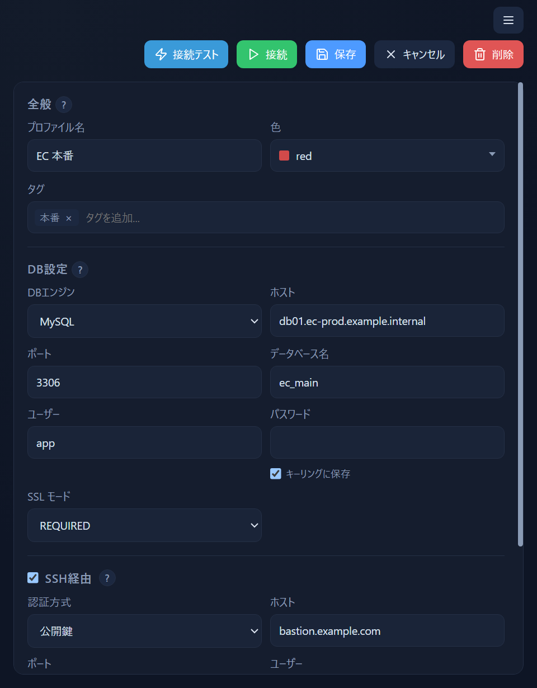
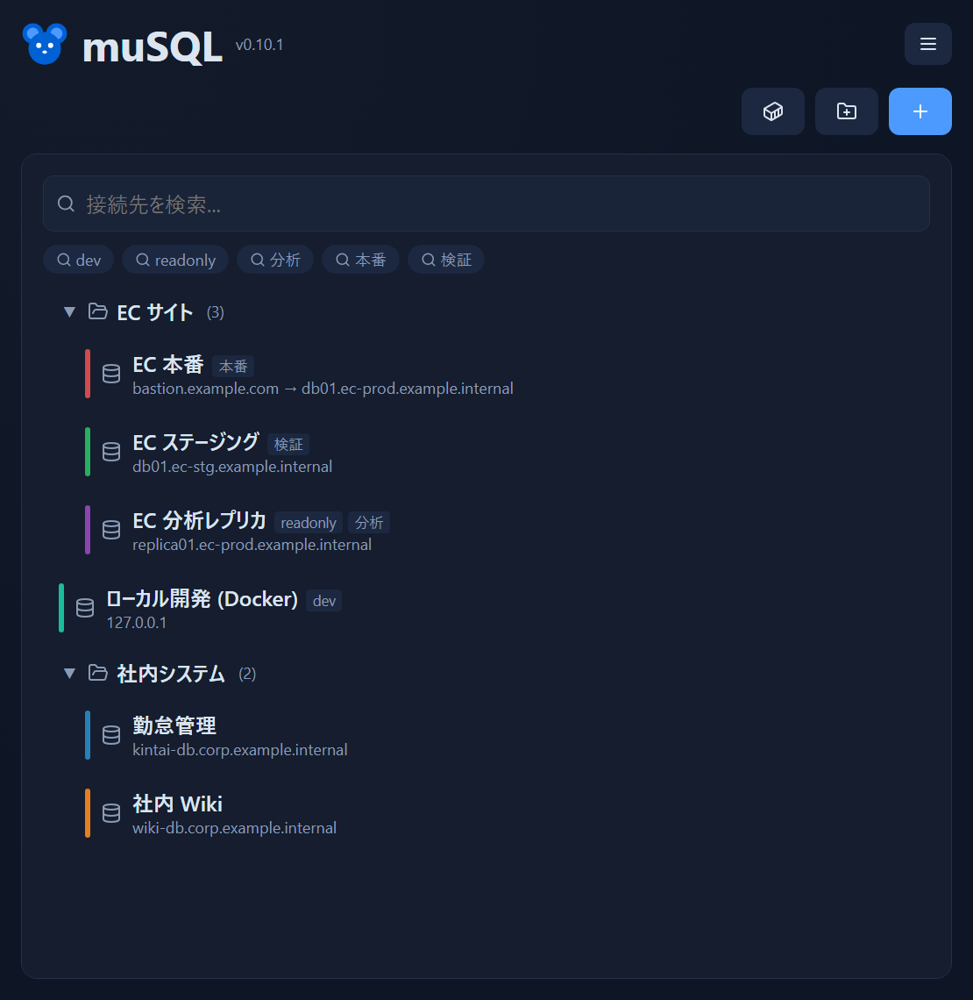

# 接続プロファイル

接続先ごとに **プロファイル** を作って管理します。プロファイルはメイン画面の一覧に並び、クリックするだけで接続できます。

- [プロファイルの作成・編集](#プロファイルの作成編集)
- [接続情報と SSL](#接続情報と-ssl)
- [SQLite のファイルを開く](#sqlite-のファイルを開く)
- [PostgreSQL に接続する](#postgresql-に接続する)
- [グループ・色・タグ](#グループ色タグ)
- [接続テスト](#接続テスト)
- [パスワードの保存方針](#パスワードの保存方針)
- [インポート / エクスポート](#インポート--エクスポート)
- [TablePlus から取り込む](#tableplus-から取り込む)

## プロファイルの作成・編集

<!-- 撮影: 設定ウィンドウ全体。基本情報 + SSL + SSH セクション、下部に「接続テスト」「保存」ボタン。 -->

- **新規作成**：メイン画面の「新規プロファイル」から。
- **編集**：一覧のプロファイルを右クリック →「編集」、またはプロファイルを開いて設定ウィンドウへ。
- **複製 / 削除**：右クリックメニューから。削除時は確認ダイアログが出ます。
- **並べ替え**：一覧上でドラッグして順序を変更できます。

## 接続情報と SSL

| 項目 | 説明 |
|------|------|
| DB エンジン | `MySQL` / `MariaDB` / `Redis` / `SQLite` / `PostgreSQL`。MySQL と MariaDB は同じ方法で接続します。違いは、一覧での表示と AI アシストへの伝え方だけです。Redis を選ぶと、既定のポートが 6379 に変わり、データベースの欄は DB 番号（空なら 0）になります。SQLite は下の [SQLite のファイルを開く](#sqlite-のファイルを開く)、PostgreSQL は [PostgreSQL に接続する](#postgresql-に接続する) を参照してください |
| ホスト / ポート | サーバーのアドレスとポート（既定 3306。PostgreSQL は 5432） |
| ユーザー / パスワード | 認証情報 |
| データベース | 初期選択するデータベース（省略可） |
| SSL モード | `DISABLED` / `REQUIRED` / `VERIFY_CA` / `VERIFY_IDENTITY` |

SSH 踏み台を使う場合は、この基本情報が **踏み台の先（リモート）から見た** MySQL の情報になります。→ [SSH 踏み台接続](ssh.md)

SSH 踏み台を経由する MySQL の接続では、`VERIFY_IDENTITY` を使えません（ホストが踏み台自身の `127.0.0.1` の場合を除く）。接続しようとするとエラーになるので、`VERIFY_CA`（証明書は検証し、ホスト名は検証しない）を選んでください。踏み台を経由すると、muSQL からはサーバーが `127.0.0.1` に見えるので、証明書のホスト名を確かめられないためです。Redis と PostgreSQL は `VERIFY_IDENTITY` のまま使えます（→ [Redis](redis.md#接続を作る)、[PostgreSQL に接続する](#postgresql-に接続する)）。

## SQLite のファイルを開く

DB エンジンで `SQLite` を選ぶと、ホストやユーザー、SSL、SSH の欄が消え、**データベースファイル** の欄だけになります。「Browse...」でファイルを選ぶか、パスを直接入力してください。拡張子は問いません。

- **存在しないファイルは開けません**。パスの打ち間違いで空のデータベースができないように、新しいファイルは作りません。
- パスワードと SSH は使いません。ファイルはこの PC から直接開きます。
- 開くと [クエリ画面](query.md) が表示されます。データベースの選択はなく、テーブル一覧から始まります。左上にはデータベース名の代わりにファイル名が出ます。
- SQL タブはタブごとに接続を持ち続けます。同じタブで実行すれば、`BEGIN` から `COMMIT` までのトランザクションや `PRAGMA` の設定、一時テーブルが次の文にも効きます。ウィンドウを閉じると接続も閉じ、確定していないトランザクションは取り消されます。
- ファイルのパスは [接続の同期](sync.md) の対象外です。同期で受け取ったプロファイルでは、各マシンでパスを指定してください。

## PostgreSQL に接続する

DB エンジンで `PostgreSQL` を選ぶと、既定のポートが 5432、ユーザーが `postgres` に変わります。SSL モードの意味と SSH 踏み台の使い方は MySQL と同じです。PostgreSQL 10 以降に対応しています。

- **データベース**：省略すると、ユーザー名と同じ名前のデータベースにつながります（psql と同じ）。開いたあとは、左上の切替ボタンでほかのデータベースへ移れます。PostgreSQL はデータベースごとに接続するので、切り替えると接続し直します。
- **テーブル一覧**：スキーマを親にしたツリーで出ます。スキーマの行をクリックすると折りたたみます。`pg_catalog` などの PostgreSQL 自身のスキーマは出ません。タブや QuickOpen では、`public` 以外のテーブルを `スキーマ.テーブル` の形で表示します。
- **SQL タブ**：タブごとに接続を持ち続けます。同じタブで実行すれば、`BEGIN` から `COMMIT` までのトランザクションや `SET` の設定、一時テーブルが次の文にも引き継がれます。ウィンドウを閉じると接続も閉じ、確定していないトランザクションは取り消されます。
- **値の表示**：サーバーが返した文字列をそのまま表示します。真偽値は `t` / `f`、`bytea` は `\x` で始まる 16 進です（Data タブの行詳細では、画像ならプレビューします）。
- **関数の定義**：`$$ … $$` で囲んだ本体の中の `;` では文を区切りません。`CREATE FUNCTION` もそのまま実行できます。

## グループ・色・タグ

接続先が増えても迷わないように整理できます。

- **グループ**：「新規グループ」で作成し、プロファイルをまとめて折りたたみできます。
- **色**：プロファイルに色を付けて、本番 / 検証などを見分けやすくします。
- **タグ**：自由なラベルを付けて分類できます。

<!-- 撮影: メイン画面。グループが1〜2個、プロファイルに色（赤=本番, 緑=検証 など）が付き、タグも見える状態。 -->

## 接続テスト

編集画面の **「接続テスト」** で、保存前に疎通を確認できます。SSH 踏み台や SSL の設定が正しいかをここで確かめられます。テストは実際の接続と同じ経路（踏み台や SSL）を通ります。

## パスワードの保存方針

muSQL は秘密情報を JSON に平文で残しません。各パスワードは **Windows 資格情報マネージャー（keyring）** に保存され、プロファイル本体（`connections.json`）には含まれません。

保存方式は種類ごとに選べます。

| 種類 | 保存する | 都度入力 |
|------|----------|----------|
| MySQL パスワード | 資格情報マネージャーに保存 | 接続前にプロンプト表示 |
| SSH パスフレーズ | 同上 | 同上 |
| SSH パスワード | 同上 | 同上 |

「都度入力」にすると、クエリ画面を開いて接続する直前に入力用モーダルが表示されます。共有 PC などで有効です。

パスワードを 1Password で管理している場合は、資格情報マネージャーへの初期取得と更新を自動化できます。[1Password 連携](1password.md) を参照してください。

## インポート / エクスポート

メイン画面のハンバーガーメニュー（≡）から、プロファイルを JSON で **エクスポート / インポート** できます。

- エクスポート時に **パスワードを含めるかどうか** を選べます。
- インポート時は **重複を検出** し、上書きするか新規として追加するかを選べます。

複数マシンで常に同期したい場合は、Dropbox などの同期フォルダを使う [接続の同期](sync.md) が便利です。

## TablePlus から取り込む

同じ PC に TablePlus（Windows 版）が入っていれば、その接続設定を muSQL のプロファイルとして取り込めます。メイン画面のハンバーガーメニュー（≡）→「TablePlus から取り込む」を選びます。ファイルを選ぶ必要はありません。muSQL が TablePlus の設定フォルダを直接読みます（TablePlus の設定で保存先を変えている場合は、その場所を読みます）。

- **取り込む項目**：接続名、ホスト、ポート、ユーザー、データベース、SSL モードと CA 証明書、SSH 踏み台（ホスト、ポート、ユーザー、認証方式、秘密鍵）、グループ、色、環境ラベル（タグになります）
- **対象の種類**：MySQL、MariaDB、PostgreSQL、Redis、SQLite。それ以外の種類の接続は取り込まず、取り込みが終わったときに一覧で知らせます
- **パスワード**：取り込みません（TablePlus が独自の形式で暗号化して保存しているため）。取り込んだプロファイルは、接続するときにパスワードの入力を求めます。保存したい場合は、プロファイルの編集で保存方式を「保存する」に切り替えてください（[パスワードの保存方針](#パスワードの保存方針)）。TablePlus で「パスワード無し」にしていた接続は、入力を求めません
- **秘密鍵**：TablePlus が覚えているファイル名を `%USERPROFILE%\.ssh` から探します。見つからなければ空欄にします（この場合、SSH エージェントと既定の鍵を試します）
- **SSL モード**：TablePlus の「Preferred」（使えれば TLS を使う）に当たるモードは muSQL に無いため、「DISABLED」にします
- **グループ**：入れ子のグループは「親 / 子」という名前の 1 つのグループにします

同じグループに同じ名前のプロファイルがあれば、[インポート](#インポート--エクスポート) と同じく、上書きするか新規として追加するかを選べます。上書きしても、そのプロファイルのパスワードの保存方式と 1Password の参照は変わりません。

次のステップ: [SSH 踏み台接続](ssh.md) / [Docker 連携](docker.md) / [接続の同期](sync.md) / [1Password 連携](1password.md)
