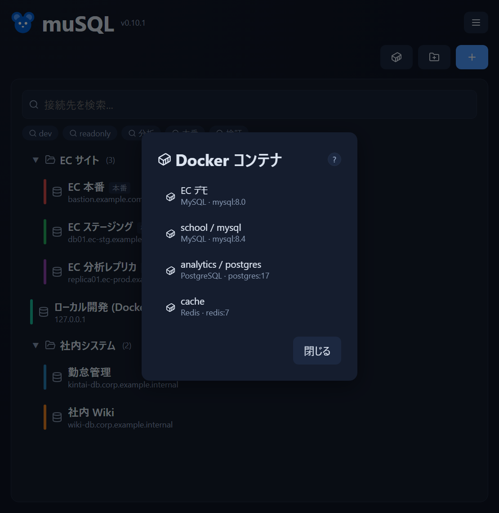

# Docker 連携

ローカルで動いている **Docker コンテナの MySQL、Redis、PostgreSQL** を自動検出して接続できます。接続情報を手で調べる必要はありません。

- [使い方](#使い方)
- [検出の条件](#検出の条件)
- [ポート未公開コンテナへの接続](#ポート未公開コンテナへの接続)
- [`musql.*` ラベルでのカスタマイズ](#musql-ラベルでのカスタマイズ)

## 使い方

<!-- 撮影: メイン画面で Docker ボタンを押した状態。検出したコンテナの一覧のモーダル。 -->

1. メイン画面の **Docker ボタン** を押す
2. 検出されたコンテナの一覧から選ぶ（名前の下に、種類とイメージが出ます）
3. **ユーザー / パスワード / SSL モード** を入力して接続する

MySQL と PostgreSQL のコンテナはクエリ画面で、Redis のコンテナは [Redis の画面](redis.md) で開きます。

資格情報はコンテナごとに記憶されます（ユーザーと SSL モードはローカル設定、パスワードは資格情報マネージャー）。最後に使った設定は、同じ種類の新しいコンテナにも初期値として適用されます。ただし Redis と PostgreSQL のパスワードは引き継ぎません。Redis は、パスワードの無いサーバーにパスワードを送ると接続に失敗するためです。PostgreSQL は、MySQL のパスワードを初期値にしないためです。

入力の初期値は種類ごとに違います。

| 種類 | ユーザー | SSL モード |
|------|----------|------------|
| MySQL | `root` | `PREFERRED` |
| Redis | 空（既定のユーザー `default`） | `DISABLED` |
| PostgreSQL | `postgres` | `DISABLED` |

MySQL の `PREFERRED` は、コンテナが TLS に対応していれば TLS を使い、対応していなければ TLS を使わずに接続します。証明書は検証しないので、コンテナが自動生成した自己署名の証明書でも接続できます。Redis の公式イメージは TLS とパスワードを使わずに動くので、パスワード欄を空のまま接続できます。パスワード（`requirepass`）を設定したコンテナには、パスワードを入力してください。PostgreSQL の公式イメージは TLS を使わずに動きます。パスワードには、コンテナの `POSTGRES_PASSWORD` の値を入力してください。

> **接続方法**：Docker への接続は、名前付きパイプ → TCP（`127.0.0.1:2375` / `2376`）の順にフォールバックします。WSL2 上の dockerd にも対応します。

## 検出の条件

起動中（running）のコンテナのうち、次の条件で MySQL、Redis、PostgreSQL のコンテナを検出します。

- **`musql.engine` ラベル**があれば、その種類として検出します（`mysql` / `mariadb` / `redis` / `postgresql`）。この版の知らない値なら一覧には出しますが、接続はできません
- ラベルが無ければ、**3306 番**（`musql.port` があればその番号）を公開しているか、**`musql.enable=true`** ラベルが付いていれば MySQL として検出します
- そのどちらでもなく、**6379 番**を公開していれば Redis、**5432 番**を公開していれば PostgreSQL として検出します

Redis や PostgreSQL を既定以外のポートで動かしているコンテナには、`musql.engine`（`redis` / `postgresql`）と `musql.port` の両方を付けてください。`musql.engine` が無いと、`musql.port` は MySQL のポートとして扱います。

## ポート未公開コンテナへの接続

ホストにポートをバインドしていないコンテナには、muSQL が一時的な **`alpine/socat` トンネルコンテナ**を作成して TCP 接続します。トンネルコンテナは `auto_remove: true`、`musql.tunnel=true` ラベル付きで、一覧には表示されません。

トンネルは、アプリ起動時、終了時、クエリ画面か Redis の画面を閉じたときに自動でクリーンアップされます。

## `musql.*` ラベルでのカスタマイズ

コンテナに次のラベルを付けると、検出時の初期値をカスタマイズできます。

| ラベル | 意味 |
|--------|------|
| `musql.engine` | 種類（`mysql` / `mariadb` / `redis` / `postgresql`）。ポートを公開していなくても検出対象になる |
| `musql.enable=true` | 3306 を公開していなくても MySQL として検出対象にする |
| `musql.name` | 一覧に表示する名前 |
| `musql.user` | 既定のユーザー |
| `musql.password` | 既定のパスワード |
| `musql.port` | ポート（無ければ種類の既定の 3306、6379、5432）。`musql.engine` が無いときは MySQL のポート |
| `musql.ssl-mode` | 既定の SSL モード（`DISABLED`、`PREFERRED`、`REQUIRED` のどれか。それ以外の値は無視） |

ラベルの値は、記憶済みの設定より優先されます。必要なラベルがそろったコンテナには、入力のモーダルを出さずに接続します。MySQL と PostgreSQL は `musql.user` と `musql.password` の両方、Redis は `musql.password` が要ります。このとき SSL モードは `musql.ssl-mode` の値になり、ラベルが無ければ上の表の初期値です。

次のステップ: [クエリ画面](query.md) / [Redis](redis.md) / [接続プロファイル](connections.md)
