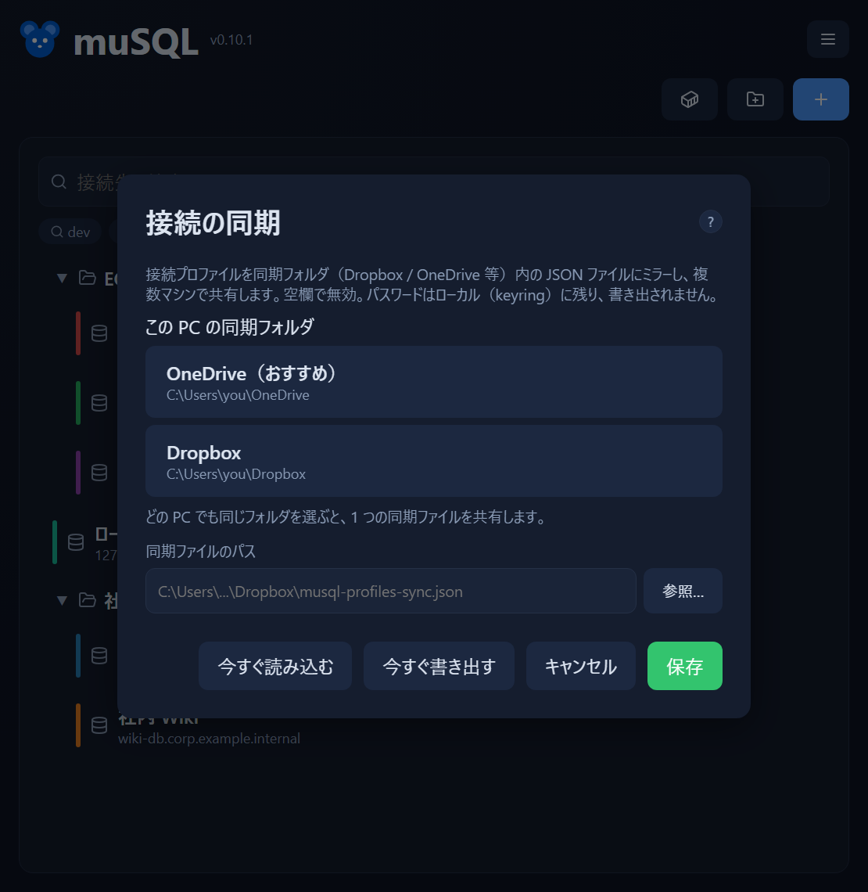

# 接続の同期

接続プロファイルを、Dropbox / OneDrive などの**同期フォルダ内の JSON ファイル**にミラーして、複数マシン間で共有できます。

- [設定](#設定)
- [動作](#動作)
- [同期されるもの・されないもの](#同期されるものされないもの)
- [注意点](#注意点)

## 設定

<!-- 撮影: メイン画面のメニュー →「接続の同期…」で開くモーダル。この PC の同期フォルダの一覧（OneDrive / Dropbox）、同期ファイルのパス入力欄 + 参照ボタン、今すぐ読み込む / 今すぐ書き出す / 保存ボタン。 -->

1. メイン画面のハンバーガーメニュー（≡）→ **「接続の同期…」** を開く
2. **この PC の同期フォルダ** から、使うフォルダを選ぶ
   - OneDrive と Dropbox のフォルダが見つかると、ここに並びます。OneDrive が「おすすめ」です
   - 選ぶと、同期ファイルのパスに `<フォルダ>\muSQL\profiles-sync.json` が入ります
   - 2 台目以降のマシンでも同じフォルダを選ぶと、同じ同期ファイルにつながります。ほかのマシンで設定済みなら「同期ファイルあり」と表示されます
3. 一覧に無いフォルダ（Google ドライブなど）を使うときは、**同期ファイルのパス** を直接指定する（「参照…」で保存ダイアログから選択、または直接入力）
   - 例：`G:\マイドライブ\musql-profiles-sync.json`
4. **保存** すると、同期ファイルを読み込んでから、その時点のプロファイルを書き出します

パスを空にして保存すると、同期は無効になります。

## 動作

- **書き出し（自動）**：プロファイルを変更するたびに、同期ファイルへ自動でミラーされます。
- **取り込み**：アプリ起動時、メイン画面がフォーカスされたとき、「今すぐ読み込む」で、同期ファイルを読み込んで反映します。
- **マージ方式**：前回同期ファイルを読み書きしたあとにほかのマシンが変えたプロファイルを取り込みます。ほかのマシンが変えていないプロファイルは、こちらの内容のまま残ります。ローカルにしか無いものも残ります。後述の**ファイルパス設定はマシンごとの値が保たれます**。
- **書き出す前の確認**：書き出す前に同期ファイルを読み直し、ほかのマシンが書き換えていたら、先にその変更を取り込んでから書き出します。同じプロファイルを両方のマシンで変えていたときは、こちらで保存した内容を書き出します。
- **競合コピー**：OneDrive や Dropbox は、2 台がほぼ同時に書き込むと、`profiles-sync-PC名.json` のような複製（競合コピー）を作ることがあります。muSQL は取り込みのときにこれを見つけ、こちらに無いプロファイルだけを取り込みます（競合コピーはいつの内容か分からないため、既にあるプロファイルは書き換えません）。同期ファイルへ書き出せたら、競合コピーを削除します。

別のマシンで編集した内容は、こちらのマシンをフォーカスしたときに取り込まれます。

## 同期されるもの・されないもの

**同期されるもの**：プロファイル名、グループ、並び順、色、タグ、ホスト、ポート、データベース名、ユーザー名、SSL モード、SSH の接続先（ホスト / ポート / ユーザー名 / `~/.ssh/config` のホスト別名）、認証方式、パスワードを保存するかどうかの設定、[1Password の参照文字列](1password.md)（`op://…`。パスワードそのものではなく、その置き場所を指す文字列）。

**同期されないもの**：

- **パスワードと SSH の秘密情報**。同期ファイルには書き出されず、各マシンの資格情報マネージャーに残ります。同期先で改めてパスワードを入力するか、そのマシンの資格情報マネージャーに保存されたものが使われます。
- **ファイルパスを指す設定** — SSH の秘密鍵ファイル、SSL の CA 証明書ファイル、SQLite のデータベースファイル。これらはマシンごとに置き場所が違うため、各マシンで個別に指定します。別のマシンで鍵のパスを変更しても、こちらのマシンの設定は上書きされません。

新しいプロファイルを別のマシンから受け取ったときは、秘密鍵や CA 証明書、SQLite のファイルのパスが空になっています。SSH や SSL 検証を使うプロファイルと SQLite のプロファイルでは、[接続設定](settings.md)で指定し直してください。

パスワードは同期されませんが、[1Password 連携](1password.md)を設定しておくと、同期先のマシンでも最初の接続時に自動で取得されます。

## 注意点

- **削除は伝播しません**。あるマシンでプロファイルを削除しても、まだそれを持つ別のマシンから復活することがあります。不要なプロファイルは各マシンで削除してください。
- 同じプロファイルを 2 台で同時に編集すると、片方の編集が残りません（取り込みではほかのマシンの内容、書き出しではこちらの内容が残ります）。1 台ずつ順番に使う運用（同時編集をしない）で最もうまく機能します。
- 色や並び順、グループも同期対象です（マシンごとの見た目の差は保てません）。
- 同期ファイルは共有フォルダに置かれる前提のため、取り込み時にパスワード類は読み捨てられます。ファイルを手で編集してパスワードを書いても反映されません。
- **同期するマシンは揃えて更新してください**。ファイルパスを同期対象から外したのは v0.6.0 より後です。片方だけを更新すると、古いバージョンのマシンが新しい同期ファイルを読んだときに、自分の秘密鍵・CA 証明書のパスを空で上書きしてしまいます。
- 更新前の同期で他マシンのパスに書き換わってしまったプロファイルは、自動では直りません。設定画面で指定し直してください。
- **新しいバージョンで書かれた同期ファイルは、古いバージョンでは上書きしません**。同期ファイルには最後に書き込んだ muSQL のバージョンが記録され、自分より新しいバージョンで書かれていた場合は書き出しを行いません（新しいバージョンが増やした項目を、古いバージョンが知らずに削ってしまうのを防ぐためです）。「今すぐ書き出す」を押した場合はその旨の警告が表示されます。この保護が働くのは双方が本機能を含むバージョンのときなので、やはりマシンは揃えて更新するのが確実です。

次のステップ: [接続プロファイル](connections.md) / [設定](settings.md)
